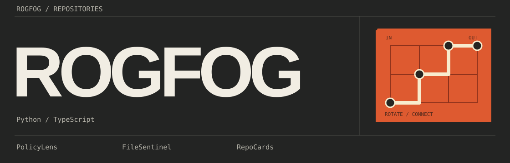
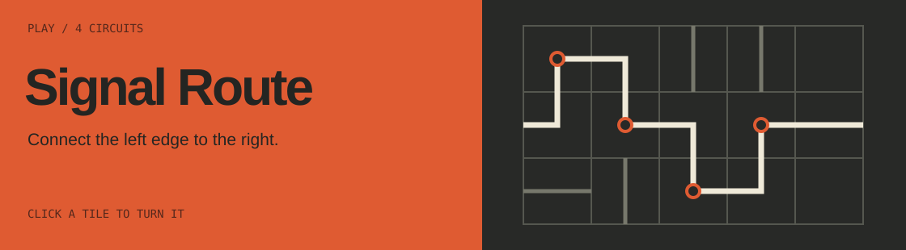

# Profile Workshop

An editable GitHub profile header, a circuit puzzle and a guide to connecting them.
Charcoal, warm lettering and an orange patch panel.



## Run

Requires Node.js 24+. No dependency installation is needed.

```sh
npm start
```

Open the printed local URL. The workshop links to the profile study, the game and
the build notes. Stop the server with Ctrl+C.

## Signal Route

Rotate tiles to connect the source on the left to the receiver on the right.
Four circuits, keyboard controls and reduced motion support. Progress lasts for
the current visit. There are no accounts, analytics or persistent browser storage.

Complete all four distinct circuits to reach the final screen. It sums the best
completed attempt on each circuit during the visit. Play again starts a fresh run;
Keep exploring leaves the completed circuits available. There are no hints.



The game runs on its own page. A profile README contains a linked preview image
because GitHub does not run arbitrary page JavaScript in README files.

## Check and build

```sh
npm test
npm run check
npm run build
python3 verify.py dist
```

The tests check rotations, reciprocal connections, board boundaries, cycles and
a reachable solution for every circuit. The profile check catches missing local
images and unresolved draft destinations. The Python standard-library check
verifies local HTML targets, anchors and SVG accessibility text. It does not
check remote availability or replace browser interaction testing.

`npm run build` copies an explicit list of site files to `dist/`. Only this
directory is uploaded to Pages. It contains no workflows, checkpoints or tests.

## Use the profile

1. Open [profile/README.md](profile/README.md). This example is configured for
   `ROGFOG/ProfileWorkshop`. Change its public URLs if your destination differs.
2. Copy its `README.md` and `assets/` into your profile repository, which must
   match your GitHub username. Adjust the name, links and descriptions.
3. Copy `profile/check.mjs` to `check.mjs`, and `profile/ci.yml` to
   `.github/workflows/ci.yml` in the profile repository.
4. Keep this project's MIT copyright and permission notice with redistributed
   source or artwork. See [the license notes](THIRD_PARTY_NOTICES.md).
5. Deploy the game first. Check its public URL, then update the profile.

The HTML profile page is a layout study. GitHub supplies its own typography,
spacing, sidebar and light/dark interface. The SVG artwork keeps its dark palette.
No avatar or account settings need to be changed.

## Publish on GitHub Pages

The included CI workflow checks pushes and pull requests with read-only
repository permissions. The Pages workflow builds and checks `main`, then uses a
separate deployment job with Pages and identity-token write permissions.

In the repository's **Settings > Pages > Build and deployment**, choose
**GitHub Actions** as the source. Push the reviewed source to `main` or run the
Pages workflow manually. Wait for a successful deployment and verify the URL
reported by that run. A workflow file alone does not prove the site is live.

The workflow follows the [GitHub Pages documentation](https://docs.github.com/en/pages/getting-started-with-github-pages/using-custom-workflows-with-github-pages).
It does not require a custom domain, paid API or third-party hosting account.

## Change the artwork or a circuit

[Build notes](how-it-works.html) explain SVG edits and README setup.
[Game source notes](game/README.md) describe the bitmask format and level paths.
Rule logic is separate from the UI in `game/logic.mjs`.

## Open the game without a server

```sh
npm run offline
```

This generates `game/offline.html` with inline CSS and JavaScript.
Rebuild it after game changes. Direct opening from disk has not been verified
in the browser used for this project. The HTTP version is the tested entry point.

## Files

| Path | Purpose |
| --- | --- |
| `assets/` | Original SVG header and game preview |
| `game/` | Playable game, pure rules and tests |
| `profile/` | Markdown, images and CI files for the profile repository |
| `signal.html`, `profile.js`, `profile.css` | HTML profile study |
| `index.html`, `workshop.css`, `how-it-works.html` | Workshop and guide |
| `build-site.mjs`, `verify.py` | Site packaging and local-reference checks |
| `.github/workflows/` | CI and Pages deployment |

## License

[MIT](LICENSE). Copyright 2026 ROGFOG. The game, layout and vector artwork are
project materials. No third-party libraries, font files or artwork are bundled.
Build tools call GitHub-maintained Actions, which remain in their own repositories.
See [THIRD_PARTY_NOTICES.md](THIRD_PARTY_NOTICES.md).
